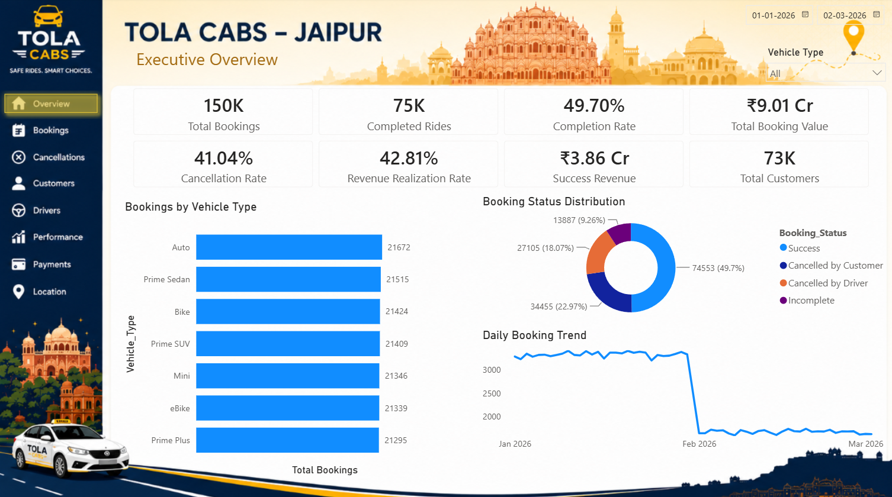
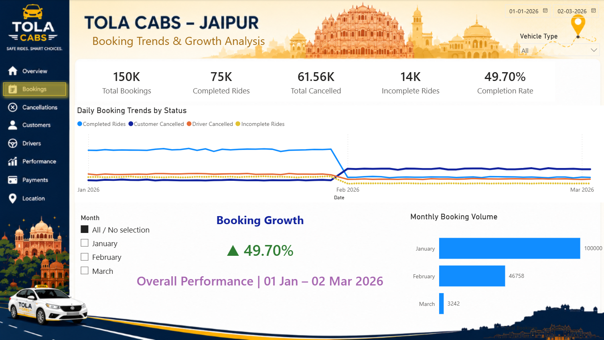
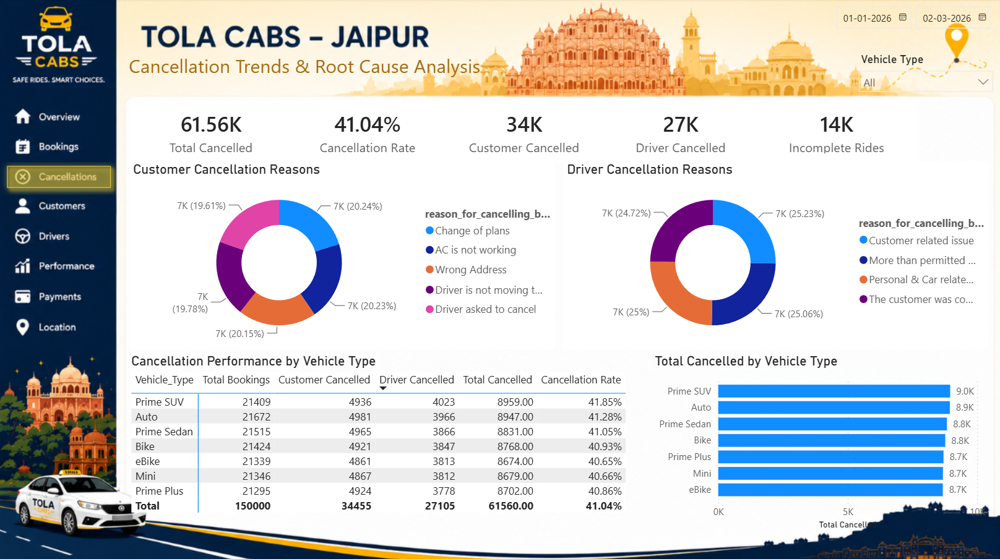
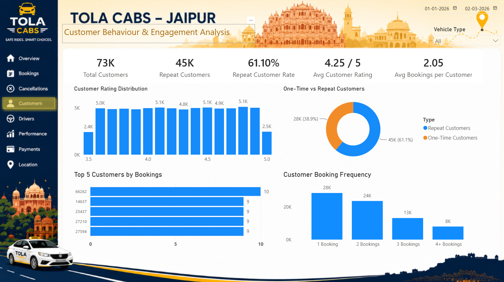
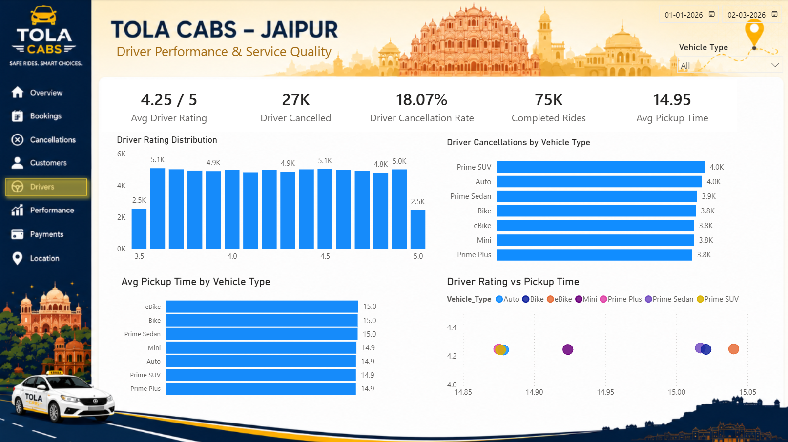
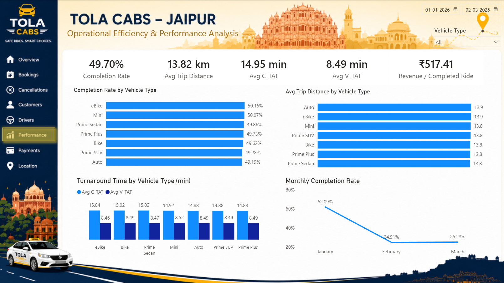
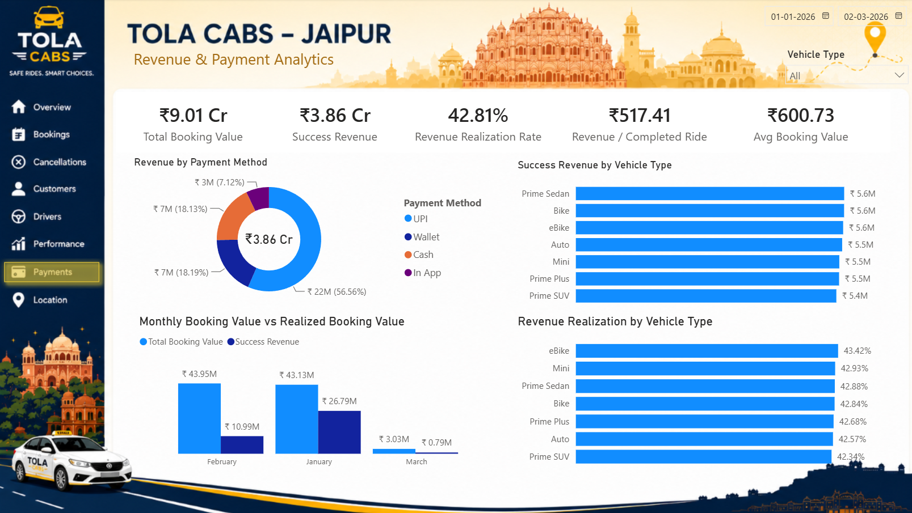
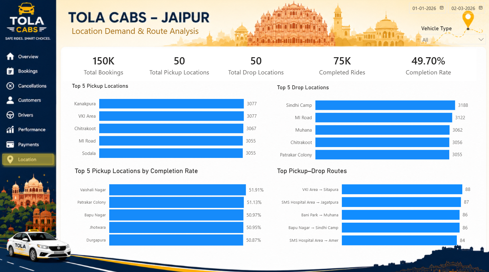

# 🚕 TOLA Cabs — Jaipur City Operations Analytics

   

**An eight-page Power BI analytics report** examining booking demand, cancellations, customers, drivers, operations, payments, and locations for a Jaipur cab-booking dataset.

> **Reporting period:** 1 January–2 March 2026 · **Records:** 150,000 bookings · **Coverage note:** March includes only 1–2 March, so March-to-February full-month comparisons are not like-for-like.

## Business problem

A ride-hailing business needs a unified view of demand, successful rides, cancellations, revenue realization, customer engagement, driver service quality, and location patterns. This project turns booking-level data into an interactive reporting experience for investigating these operational questions.

## Executive dashboard



### Validated headline KPIs

| Metric | Result |
|---|---:|
| Total bookings | **150,000** |
| Completed rides | **74,553** |
| Completion rate | **49.70%** |
| Customer cancellations | **34,455** |
| Driver cancellations | **27,105** |
| Total cancellations | **61,560** |
| Cancellation rate | **41.04%** |
| Incomplete rides | **13,887** |
| Total booking value | **₹9.01 Cr** |
| Successful-ride revenue | **₹3.86 Cr** |
| Revenue realization rate | **42.81%** |
| Distinct customers | **73,036** |
| Repeat customers | **44,627** |
| Repeat customer rate | **61.10%** |
| Average driver / customer rating | **4.25 / 5** |
| Average trip distance | **13.82 km** |
| Average C_TAT / V_TAT | **14.95 / 8.49 min** |
| Unique pickup / drop locations | **50 / 50** |

*Rates and rounded currency values are derived from the dataset and validated with Power BI DAX queries.*

## Eight report pages

### 01 · Executive Overview

Company-wide KPIs, booking status distribution, vehicle-category volume, and daily booking trends.


### 02 · Booking Trends & Growth Analysis

Daily booking trends by status, monthly volume, and an interactive month selector. February growth compares February with January; March compares the **partial March period** with February. The All selection shows overall completion performance, **not** month-over-month growth.



### 03 · Cancellation Trends & Root Cause Analysis

Customer and driver cancellation patterns, reason breakdowns, and vehicle-level cancellation performance.



### 04 · Customer Behaviour & Engagement Analysis

Distinct customers, repeat customers, customer ratings, top customers, and booking frequency groups.



### 05 · Driver Performance & Service Quality

Driver ratings, driver cancellations, pickup turnaround time, and comparisons across vehicle categories.



### 06 · Operational Efficiency & Performance Analysis

Ride completion, trip distance, C_TAT, V_TAT, and operational performance by vehicle and month.



### 07 · Revenue & Payment Analytics

Total booking value, successful-ride revenue, revenue realization, payment-method contribution, and vehicle-category revenue.



### 08 · Location Demand & Route Analysis

Top pickup and drop locations, completion performance by pickup location, and frequently booked pickup–drop routes.



## Selected analytical findings

- **49.70% of bookings were completed**; **41.04% were cancelled** by customers or drivers, with the remainder incomplete.
- **January:** 100,000 bookings and 62.09% completion; **February:** 46,758 bookings and 24.91% completion; **1–2 March:** 3,242 bookings and 25.23% completion. The shift warrants investigation; its cause is not established by this analysis.
- **61.10% of distinct customers booked at least twice** in the analyzed data: 44,627 out of 73,036.
- **UPI accounted for approximately 56.56% of successful-ride revenue**, the largest share among payment methods.
- **eBike recorded the highest vehicle-category completion rate** at approximately 50.16%; **Prime SUV recorded the highest cancellation rate** at approximately 41.85%. The differences across vehicle types are modest.

## Tools and approach

| Tool | Role |
|---|---|
| SQL | Data preparation and booking analysis scripts |
| Power BI Desktop | Eight-page interactive reporting |
| Power Query | Data shaping and transformation |
| DAX | KPIs, ratios, customer segmentation, and dynamic comparisons |
| CSV | Booking-level source data |

### Data model

The report uses **`tola bookings`** as its central fact table, linked to **`Calendar`** through a one-to-many date relationship with single-direction filtering. A dedicated **`_Measures`** table organizes calculations. Disconnected helper tables support the booking-month selector, customer type, and booking-frequency groupings.

The model is **not described as a fully normalized star schema**: vehicle, payment, location, and booking-status attributes remain in the booking fact table.

### Calculation checks

Key measures were cross-checked in Power BI DAX Query View. The validation covered overall booking statuses, monthly booking totals, repeat-customer counts and frequency bands, payment-method revenue, vehicle-level completions/cancellations, driver/customer ratings, turnaround times, and distinct locations. **Not every possible slicer combination or refresh scenario has been independently tested.**

## Repository contents

```text
tola-cabs-jaipur-analytics/
├── 01_bookings.csv
├── 02_bookings.sql
├── 03_tola_bookings/
│   └── tola_bookings.sql
├── 04_TOLA_Cabs.pbix
├── 05_BG_TOLA_Cabs.png
├── 06_Documentation/          # Currently empty; optional future documentation
├── screenshots/
│   ├── 01_Executive_Overview.png
│   ├── 02_Booking_Trends_and_Growth.png
│   ├── 03_Cancellation_Analysis.png
│   ├── 04_Customer_Analytics.png
│   ├── 05_Driver_Performance.png
│   ├── 06_Operational_Performance.png
│   ├── 07_Revenue_and_Payments.png
│   └── 08_Location_and_Route_Analysis.png
├── README.md
└── LICENSE
```

## Run the report

1. Clone the repository:

   ```bash
   git clone https://github.com/aaswani365/tola-cabs-jaipur-analytics.git
   ```

2. Open **`04_TOLA_Cabs.pbix`** in Microsoft Power BI Desktop.
3. Explore the eight pages and their slicers. If refreshing the data, update the source path to the local **`01_bookings.csv`** file in Power Query before selecting **Refresh**.

## Interpretation notes

- **March is partial (1–2 March 2026).** A March-versus-February percentage based on raw booking totals should not be presented as a like-for-like monthly change.
- The strong January-to-February change is a **pattern in the supplied dataset**; it does not by itself establish a business cause.
- **Total booking value** includes booking values across statuses, whereas **successful-ride revenue** includes only completed/successful bookings. These are analytical metrics, not audited financial receipts.
- Customer repeat rates describe **repeat booking activity within this dataset**, not long-term customer retention.

## Author

**Akshay Aswani** · Data Analytics & Business Intelligence Portfolio

[GitHub profile](https://github.com/aaswani365) · [Portfolio](https://aaswani365.github.io/)

**Project status:** Completed — eight report pages, with core KPI reconciliation performed.
